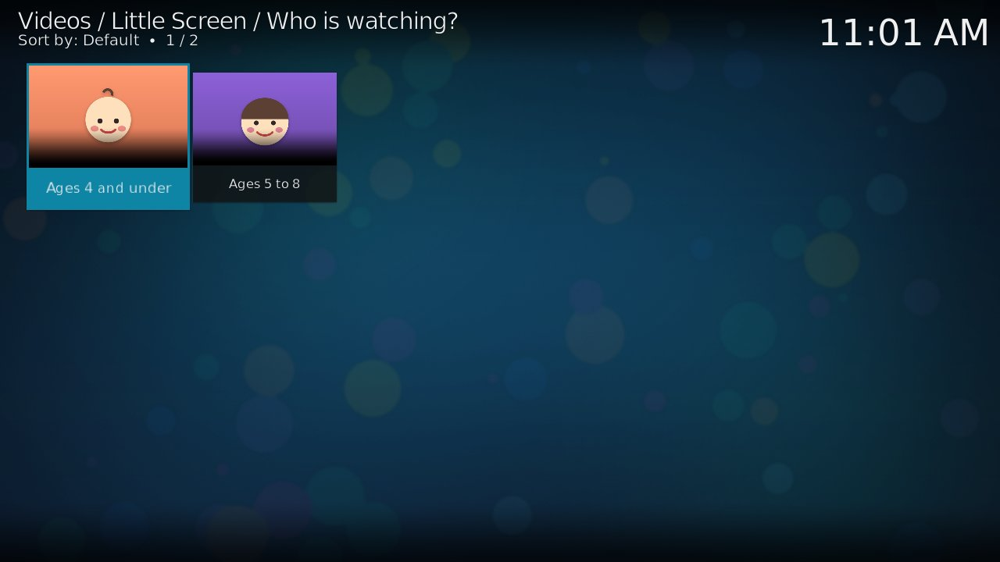
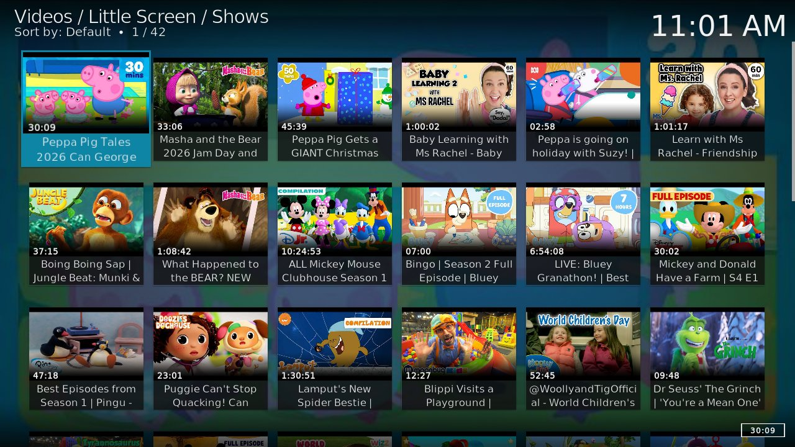
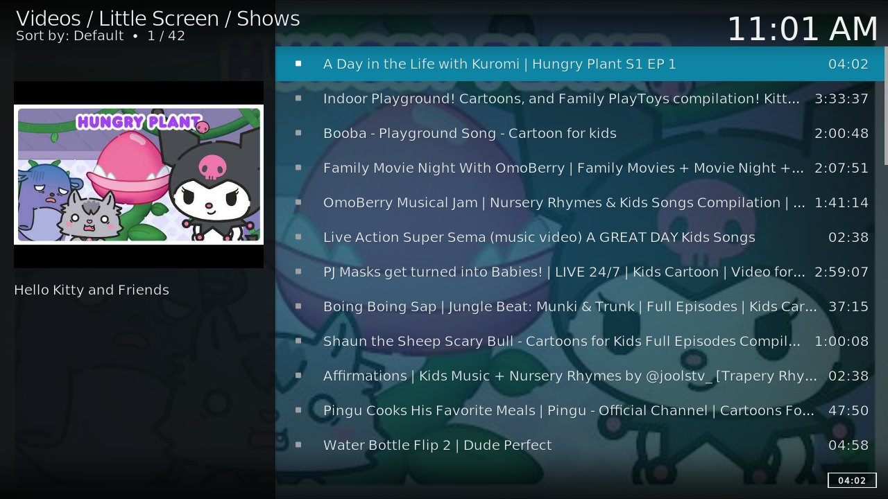
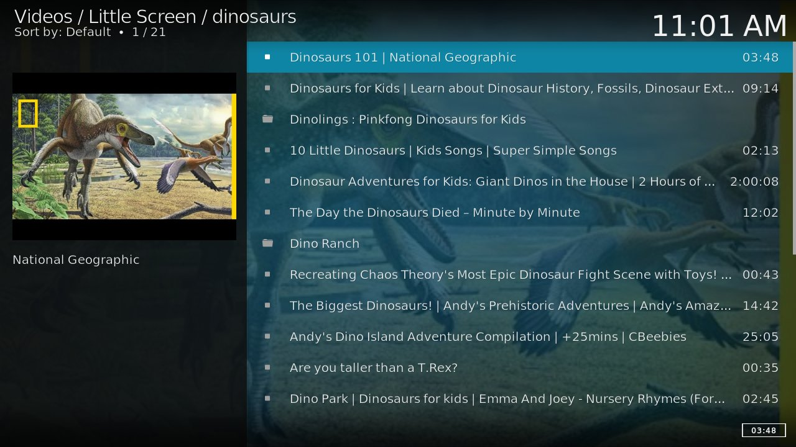

# Little Screen


A Kodi add-on that shows the **YouTube Kids catalogue** on your TV: shows, music, learning and
more, picked for the age of the child who is watching. Each child gets a profile: big
pictures for toddlers, or a list with titles and search for older children.

Little Screen is **unofficial** and not affiliated with, endorsed by or sponsored by YouTube
or Google. It reads the same public interface as youtubekids.com, signed out, and plays the
videos through the [YouTube add-on](https://github.com/anxdpanic/plugin.video.youtube).

## Screenshots

<table>
<tr>
<td width="50%"><br>
Who is watching? One tile per profile.</td>
<td width="50%"><br>
Big pictures for the youngest (ages 4 and under).</td>
</tr>
<tr>
<td width="50%"><br>
A list with titles and channels (ages 5 to 8).</td>
<td width="50%"><br>
Search inside the YouTube Kids catalogue.</td>
</tr>
</table>

Kodi 21 with its default skin, English, default add-on settings. Taken by
`scripts/screenshots.sh` (headless Kodi in Docker).

## Install

Little Screen comes from its own Kodi repository at
**<https://lipelix.github.io/kodi-littlescreen/>**. Installing the repository once gives you
updates automatically. It needs Kodi 20 (Nexus) or later.

1. In Kodi, open **Settings → System → Add-ons** and turn on **Unknown sources**.
2. Get the repository zip, either way:
   - download `repository.littlescreen-1.0.0.zip` from the
     [repository page](https://lipelix.github.io/kodi-littlescreen/) and copy it to a place
     Kodi can open (USB stick, network share), or
   - in **Settings → File manager → Add source**, enter
     `https://lipelix.github.io/kodi-littlescreen/` and name it `littlescreen`.
3. **Settings → Add-ons → Install from zip file** → pick the zip (or the `littlescreen`
   source and the zip in it).
4. **Install from repository → Little Screen repository → Video add-ons → Little Screen →
   Install.** Kodi installs the YouTube add-on with it.

Then open **Videos → Add-ons → Little Screen**.

## Profiles

Up to three profiles, set in the add-on settings (**Profiles**). With more than one turned
on, Little Screen asks "Who is watching?"; with one, it opens it straight away.

| Setting | What it does |
|---|---|
| Show this profile | Turns the profile on or off. Profiles 1 and 2 are on at first. |
| Name | Shown on the profile tile. Empty: the age group ("Ages 4 and under", ...). |
| Age group | **4 and under**, **5 to 8** or **9 to 12**. YouTube Kids picks the videos for it. |
| Look | **Big pictures (toddlers)**: large tiles, no text, no search. **List with titles**: titles, channel names, search. |
| Allow search | Search inside the YouTube Kids catalogue for this age (list look only). |
| Play the next video automatically | See [Autoplay](#autoplay). On at first. |

Each category (Shows, Music, Learning, ...) ends with tiles for the channels behind its
videos, so a child can open more from a channel they like.

## Language and region

By default the catalogue follows Kodi: the language is Kodi's interface language, the region
is Kodi's region (**Settings → Interface → Regional**). To pick another catalogue, fill in
**Language** (`en`, `de`, `cs`, ...) and **Region** (`US`, `DE`, `CZ`, ...) in the add-on
settings. Languages YouTube Kids does not offer fall back to English.

### Language filter

A national catalogue often mixes in videos in other languages. **Videos in** decides what
stays:

- **Only the catalogue language** (default): videos that are clearly in another language
  are hidden. YouTube does not say which language a video is in, so Little Screen guesses
  from the title, the channel name and what it learned about the channel before. **A video
  whose language is unclear always stays.**
- **Any language**: nothing is hidden.

How well it guesses depends on the language. Czech and Slovak are told apart word by word.
For other languages only the writing system (Latin, Cyrillic, Greek, Arabic, Japanese, ...)
and language names in titles ("in Spanish", "• Polski") count: in a German catalogue a
Russian or Japanese video is hidden, an English one usually is not. Adding word lists for a
language is described in [AGENTS.md](AGENTS.md#language-filter-adding-a-pack).

## Autoplay

With **Play the next video automatically** on, picking a video plays it and then the videos
after it in the same list (up to 50 videos in all), and stops there. Nothing outside the list
starts on its own: Little Screen does not use YouTube's suggested videos, and Kodi's own
"play next" setting stays untouched, so other add-ons behave as before.

## Privacy

- No account, no sign-in, no analytics. Little Screen talks only to youtubekids.com, signed
  out; the YouTube add-on fetches the videos when they play (see its own settings for what it
  does).
- What it keeps stays on the device, in the add-on's profile folder: the youtubekids.com
  client version (refreshed daily), the titles of recently listed videos (for the autoplay
  queue) and what it learned about channels (their language, whether they have videos for an
  age group). Little Screen keeps no watch history.

## Limits

- **Unofficial interface.** Little Screen uses the interface behind youtubekids.com, which
  YouTube can change at any time. When it does, the add-on may stop working until an update.
- **Profiles are not a lock.** A child can switch profiles, open the add-on settings or leave
  Little Screen. To keep them in, use Kodi's own protection: **Settings → Profiles → General
  → Lock** (master lock for settings and add-ons), or a separate Kodi profile with only
  Little Screen.
- **The catalogue is YouTube's.** Little Screen shows what YouTube Kids offers for the age
  group and region; it does not review videos. A category is a fixed set of about 36 videos
  plus its channels; search finds more.
- Some regions return a very small catalogue (one category).

## macOS: videos do not play

On macOS the YouTube add-on 7.4.x fails to play videos with *"Could not connect to
server"*. It runs a small HTTP server for the player that listens on `127.0.0.1`, but on
macOS it then sends the player to the computer's network address, where nobody listens. This
is a YouTube add-on issue, not Little Screen's, and other systems are not affected.

**Fix:** open the YouTube add-on's settings → **Advanced** → **HTTP Server** and set the IP
address to `0.0.0.0` (or use **Select listen IP** and pick the computer's address). Restart
Kodi.

**Trade-off:** the server then answers devices on your local network, not only this
computer. It accepts only private network addresses (and those in its **IP whitelist**), so
it is not reachable from the internet unless your router forwards its port (50152); use it
on a network you trust.

## Development

The code, how it works and its Kodi quirks are described in [AGENTS.md](AGENTS.md). Short
version:

```bash
python3 -m venv .venv && .venv/bin/pip install -r requirements-dev.txt
.venv/bin/python -m pytest -q
.venv/bin/ruff check . && .venv/bin/ruff format --check .
./scripts/build.sh                        # dist/plugin.video.littlescreen-<version>.zip
.venv/bin/python scripts/build_repo.py    # dist/pages: the Kodi repository
./scripts/check-kodi-versions.sh          # Kodi 20, 21, 22 headless in Docker: list and play
./scripts/screenshots.sh                  # docs/screenshots from a clean Kodi 21 in Docker
```

## Licence

[MIT](LICENSE). Little Screen is not affiliated with YouTube or Google; "YouTube" and
"YouTube Kids" are trademarks of Google LLC.
